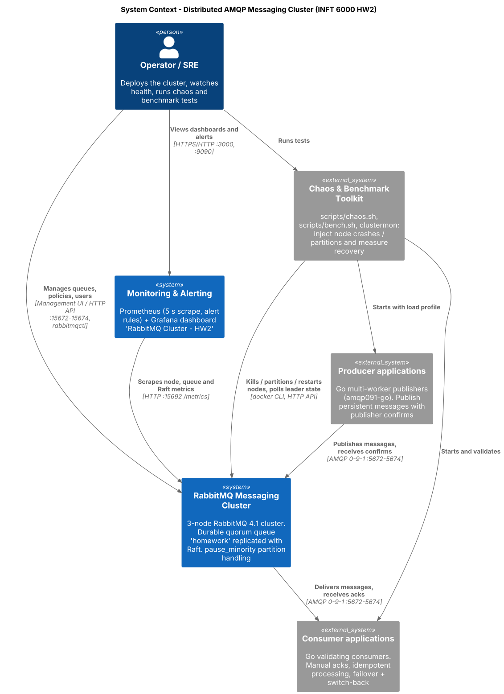
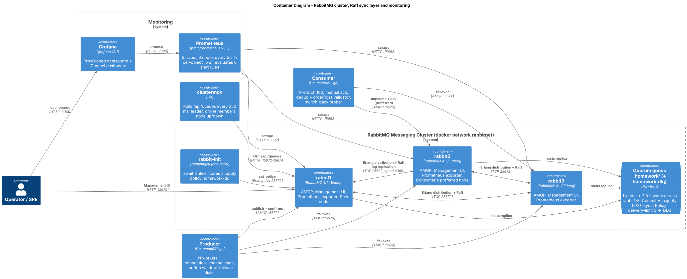
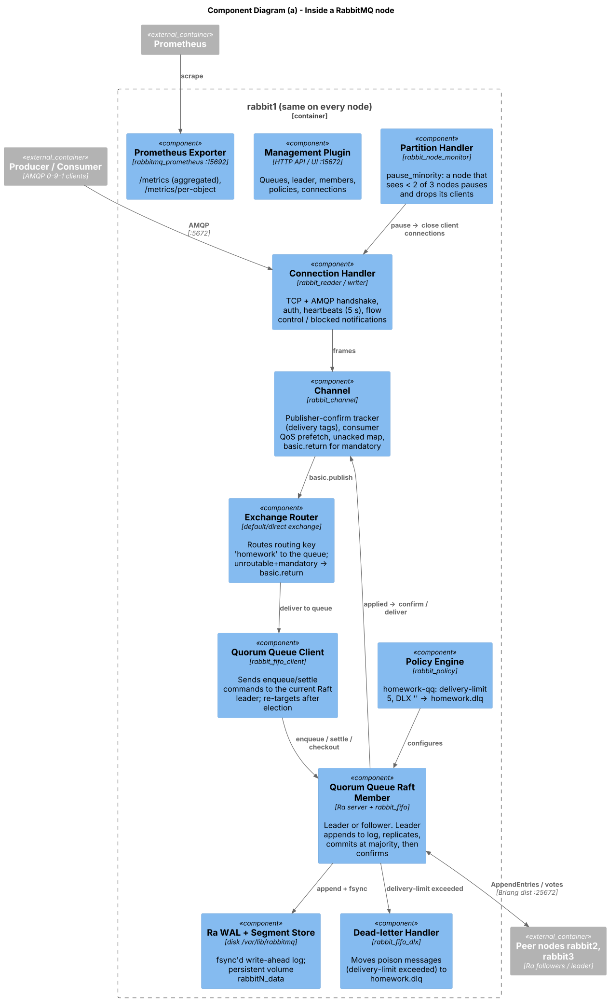
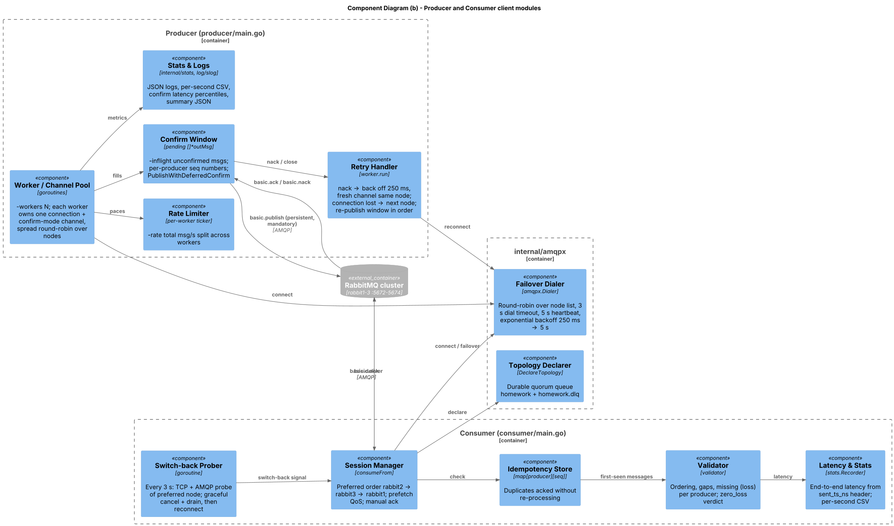
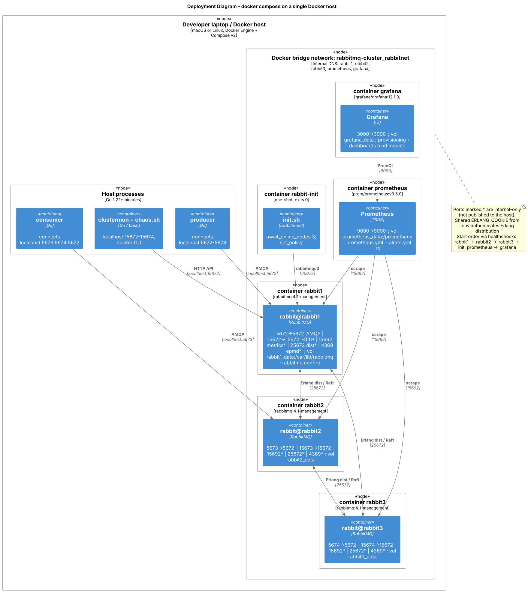

# Architecture Design Document — Distributed AMQP Messaging Cluster

INFT 6000 Principles of Distributed Systems · Homework 2

## 1. Goal and scope

Build, operate and validate a **highly available, multi-node AMQP message broker** that:

* keeps accepting and delivering messages when any single node crashes or is network-partitioned,
* never loses a message that the broker has **confirmed** to a publisher,
* exposes enough telemetry to see node health, queue depth, throughput and Raft leader changes,
* is exercised by custom clients that implement publisher confirms, failover and manual acks.

Out of scope: multi-datacenter replication (federation/shovel), TLS, and Kubernetes deployment.
Section 11 lists how these would be added.

## 2. Technology choices

| Decision | Choice | Why | Alternatives considered |
|---|---|---|---|
| Broker | **RabbitMQ 4.1** (`rabbitmq:4.1-management`) | Native clustering, quorum queues backed by Raft, built-in management UI and Prometheus exporter | Artemis primary/backup: replication is pairwise, and failover needs a pair. Qpid Dispatch Router is brokerless, so there's no durable store to test persistence against. |
| Replicated queue type | **Quorum queue** (Raft, via the Ra library) | Durable, replicated, majority-commit semantics, automatic leader election. Classic mirrored queues were removed in RabbitMQ 4.0. | Streams (append-only log, different consumption model) |
| Cluster size | **3 nodes** | Smallest size that tolerates 1 failure while keeping a Raft majority (2 of 3) | 5 nodes would tolerate 2 failures at higher resource cost |
| Peer discovery | `classic_config` (static list) | Deterministic for a fixed docker-compose topology | DNS, Consul, K8s peer discovery |
| Partition handling | **`pause_minority`** + `net_ticktime = 15` | Prefers consistency (CP): the minority side stops serving clients instead of diverging | `autoheal` (favors availability, may discard data), `ignore` |
| Orchestration | Docker Compose v2 | One command brings up 3 brokers, an init job, Prometheus and Grafana | Ansible, Kubernetes + Cluster Operator |
| Monitoring | Prometheus v3.5 + Grafana 12.1 + RabbitMQ management UI | Metrics come from the `rabbitmq_prometheus` plugin, so no extra exporter is needed | Datadog / ELK |
| Clients | **Go 1.22+** with `rabbitmq/amqp091-go` v1.16 | Goroutines make multi-worker load generation cheap. Deferred publisher confirms. | Python pika/aio-pika, Java client |

## 3. Cluster topology

Three identical RabbitMQ containers (`rabbit1..3`) sit on one Docker bridge network, `rabbitnet`,
and share an Erlang cookie (from `.env`). Compose health checks make them start in a fixed
order: `rabbit1 → rabbit2 → rabbit3`. A one-shot `rabbit-init` container then waits for all 3
nodes (`rabbitmqctl await_online_nodes 3`) and applies the queue policy. Prometheus starts after
`rabbit3` is healthy, and Grafana starts after Prometheus.

| Container | Host ports | Internal ports | Volume |
|---|---|---|---|
| rabbit1 | 5672→5672 (AMQP), 15672→15672 (Mgmt) | 15692 metrics, 25672 Erlang dist, 4369 epmd | `rabbit1_data:/var/lib/rabbitmq` |
| rabbit2 | 5673→5672, 15673→15672 | same | `rabbit2_data` |
| rabbit3 | 5674→5672, 15674→15672 | same | `rabbit3_data` |
| rabbit-init | – | uses 25672 of rabbit1 | – |
| prometheus | 9090→9090 | – | `prometheus_data` |
| grafana | 3000→3000 | – | `grafana_data` |

`rabbitmq.conf` (identical on all nodes):

```ini
cluster_formation.peer_discovery_backend = classic_config
cluster_formation.classic_config.nodes.1 = rabbit@rabbit1   # .2 rabbit2, .3 rabbit3
cluster_partition_handling = pause_minority
net_ticktime = 15
default_queue_type = quorum
prometheus.tcp.port = 15692
```

## 4. Consensus configuration (quorum queues / Raft)

**Queue:** `homework` is a durable quorum queue with 3 replicas, one per node. `homework.dlq` is
also a quorum queue. Both are declared by the clients (`x-queue-type: quorum`). Delivery
behaviour is set by an **operator policy** rather than queue arguments, so it can change without
redeclaring the queue:

```text
policy homework-qq  pattern ^homework$  apply-to quorum_queues
  delivery-limit = 5                      # poison-message protection
  dead-letter-exchange = ""               # default exchange
  dead-letter-routing-key = homework.dlq  # -> DLQ
```

**Write path (what a publisher confirm means):**

1. The producer sends `basic.publish` (persistent, mandatory) on a channel in confirm mode.
2. The channel's quorum-queue client sends an `enqueue` command to the Raft **leader**.
3. The leader appends the entry to its write-ahead log (fsync) and replicates it to the followers
   (`AppendEntries` over Erlang distribution, port 25672).
4. Once a **majority (2 of 3)** has the entry persisted, the leader commits and applies it, and
   the channel sends `basic.ack` to the producer.

So a confirmed message survives the loss of any single node, and even the crash of all three
nodes at once (the full-restart test). If the queue has no leader, or cannot reach a majority, the
publish is **nacked** or simply not confirmed. The client then retries.

**Read path:** consumers attach to any node, and deliveries come from the leader. The ack
(`settle`) is also a Raft command, so a delivered-but-unacked message is returned and redelivered
if the consumer's channel dies.

**Leader placement and election:** the leader is placed on the node where the queue was declared
(`client-local` locator). The chaos scripts use this to start every scenario with a known leader.
When the leader's node dies, followers notice through Erlang process monitoring and the Ra failure
detector, an election runs, and the term number increases. The Grafana panel *Raft term per queue*
shows each election as a step.

| Nodes available | Queue state | Effect on clients |
|---|---|---|
| 3 / 3 | normal | – |
| 2 / 3 | available (majority) | Failover on the clients of the lost node. A new leader is elected if the leader was lost. |
| 1 / 3 | **unavailable** (no majority) | Publishes not confirmed and deliveries stop, but nothing is lost. Under `pause_minority` the last node also pauses itself. |

## 5. Network partitions

* **Detection.** A crashed node is noticed immediately, because its TCP connections reset. A
  *silent* partition (packets dropped) is noticed through `net_ticktime` (15 s; in testing the minority
  node paused 18.6–21.6 s after the partition; the default 60 s would mean roughly a minute or more).
* **Policy.** `pause_minority`: the side that can see fewer than half of the nodes stops its
  `rabbit` application, closes all client connections, and keeps checking for peers. When the
  partition heals, it restarts and its quorum-queue members catch up from the leader's log.
* **CAP position.** CP. The minority side refuses service rather than accepting writes that
  could diverge.
* **Client view.** The minority node's AMQP connections are closed (or time out). Clients fail
  over to a majority node and re-publish anything unconfirmed.

## 6. Client design

### Producer (`producer/main.go`)

| Concern | Implementation |
|---|---|
| Concurrency | `-workers N` goroutines, each with its own connection and confirm-mode channel (a channel pool of size N). Workers start on different nodes, round-robin, to spread load. |
| Publisher confirms | `PublishWithDeferredConfirmWithContext`, with a bounded window of `-inflight` unconfirmed messages per worker. Message *k* counts as delivered only after its `basic.ack`. |
| Durability | `DeliveryMode=Persistent`, durable quorum queue, `mandatory=true` (returns are logged and counted). |
| Retry / at-least-once | Every unconfirmed message stays in the `pending` window. **Nack:** wait 250 ms, then re-send the window on a *fresh channel to the same node*. **Connection loss:** move to the *next* node and re-send the window in sequence order. |
| Failover dialer | `internal/amqpx.Dialer`: walks the node list round-robin. 3 s dial and handshake timeout, 5 s heartbeat, exponential backoff 250 ms → 5 s when all nodes are down. |
| Partition safety | Every socket write has a **5 s deadline** (`deadlineConn`), so a black-holed TCP connection fails fast instead of hanging. This was a bug found by the partition test. |
| Validation metadata | Headers `run_id`, `producer_id`, `seq` (per-worker, monotonic), `sent_ts_ns`. `MessageId = <run>-p<worker>-<seq>`. |
| Load shaping | `-rate` (total msg/s), `-size`, `-count`. |
| Observability | JSON logs (`log/slog`), per-second CSV, summary JSON with throughput and confirm-latency percentiles. |

### Consumer (`consumer/main.go`)

| Concern | Implementation |
|---|---|
| Manual acks | `autoAck=false`. A message is acked only after processing; QoS `-prefetch` bounds unacked deliveries. |
| Failover | Preference order `rabbit2 → rabbit3 → rabbit1` (kept from the team's original design). On channel or connection loss it moves to the next node. |
| Switch-back | While failed over, a probe checks the preferred node every 3 s (TCP, then a real AMQP handshake, since a paused node refuses AMQP). When it succeeds: `basic.cancel`, **drain and ack** the prefetched deliveries, then reconnect. This avoids requeues and keeps ordering. |
| Idempotency | A set of seen `(producer_id, seq)` pairs. A duplicate (producer re-publish or broker redelivery) is acked **without** being processed again. If an ack fails, the redelivered copy is recognized as a duplicate. |
| Validation | Per producer: out-of-order arrivals, gaps, missing sequence numbers (**loss**), and the `zero_loss` verdict. End-to-end latency uses `sent_ts_ns`. |

### Delivery semantics achieved

* **No loss of confirmed messages:** verified in 8/8 chaos scenarios (see REPORT.md).
* **At-least-once delivery, exactly-once processing:** the broker and producer may duplicate; the
  consumer's idempotency check removes the duplicates.
* **Ordering:** per-producer FIFO in steady state. During failures, a few messages can arrive out
  of order: when a pipelined window is partly nacked, later messages commit before the retried
  earlier ones. Full ordering under failure would need `-inflight 1` (about 5–10× lower
  throughput) or a resequencing buffer in the consumer.

## 7. Monitoring and management

* **Management UI / HTTP API** on every node (15672–15674): queues, leader and members, policies,
  connections, `rabbitmqctl` / `rabbitmq-queues` CLI.
* **Prometheus** scrapes every node every 5 s (`/metrics`, aggregated) and every 15 s
  (`/metrics/per-object`, per-queue Raft data).
* **Alert rules** (`prometheus/alerts.yml`):

| Alert | Condition | Severity |
|---|---|---|
| RabbitMQNodeDown | `up == 0` for 15 s | critical |
| RabbitMQClusterDegraded | fewer than 3 nodes up for 15 s | warning |
| RabbitMQQuorumLost | fewer than 2 nodes up for 10 s | critical |
| RabbitMQQueueBacklog | more than 50k ready messages for 1 m | warning |
| RabbitMQMemoryAlarm / DiskAlarm | broker resource alarm raised | critical |

* **Grafana dashboard** "RabbitMQ Cluster - HW2" (provisioned, 17 panels): nodes up, node status,
  messages / consumers / connections / unacked; throughput (published, confirmed, delivered,
  acked, redelivered); queue depth; per-queue messages; dead-lettered and unroutable; **Raft
  term** (elections); Raft commit latency and commit index; connections and consumers per node
  (shows failover); memory, disk, alarms. Every query was checked against a live Prometheus.
* **clustermon** (`cmd/clustermon`): a 250 ms poller of leader, online members and node liveness,
  used to time recoveries in chaos tests. Liveness uses the node-local
  `/api/health/checks/local-alarms`. The cluster-wide queue view can block during a partition
  until `net_ticktime` expires; this was observed and is documented in the report.

## 8. Failure recovery policies

| Failure | Detection | Automatic recovery | Client behaviour | Operator action |
|---|---|---|---|---|
| Follower node crash | TCP reset, under 1 s | Queue keeps a 2/3 majority; no election | Clients on that node fail over and re-publish unconfirmed messages | Restart the node; it catches up from the leader's log |
| Leader node crash | Under 1 s | New leader elected (sub-second) | Brief nacks/stall, then the producer retries; consumer continues | Restart the node; it rejoins as a follower |
| Silent partition of 1 node | `net_ticktime` (about 15 s); Raft sooner | Minority node pauses (`pause_minority`); majority elects a leader if needed | 5 s write deadline and heartbeats lead to failover | Fix the network; the node unpauses and resyncs automatically |
| 2 of 3 nodes lost | Immediate | None possible (no quorum); remaining node pauses | Producers keep retrying with backoff and consumers wait. Nothing is lost. | Bring back at least 1 node; service resumes automatically |
| All nodes crash | – | Raft logs on persistent volumes are replayed at restart | Clients reconnect | `docker compose start`. Every confirmed message is recovered. |
| Poison message | Redelivered more than 5 times | Dead-lettered to `homework.dlq` | – | Inspect the DLQ, fix the consumer, re-publish |
| Memory/disk alarm | Broker watermarks | Publishers blocked (flow control) | Publishes block; confirms delayed | Scale consumers or add resources |
| Rolling upgrade / restart | Planned | One node at a time keeps quorum | Failover and switch-back | `docker restart rabbitN`, waiting for 3/3 between nodes |

## 9. C4 diagrams

Sources: `docs/c4/*.puml` (C4-PlantUML). Rendered as PNG and SVG next to them.
Re-render with `java -jar plantuml.jar -tpng docs/c4/*.puml`.

### 9.1 System context


### 9.2 Container


### 9.3 Component — broker internals


### 9.4 Component — client modules


### 9.5 Deployment


## 10. Security notes

* The Erlang cookie is generated per environment into a git-ignored `.env`. A cookie had been
  committed in an earlier revision, so **rotate it** before any shared deployment.
* `admin/admin` is for local use only. In production, use per-application users with
  least-privilege permissions, TLS on 5671 and 15671, and Grafana behind SSO.

## 11. Limitations and next steps

* All containers run on one Docker host, so host failure isn't tolerated. For real HA, spread
  nodes across hosts or availability zones (Kubernetes + RabbitMQ Cluster Operator).
* The consumer's idempotency store is in memory. A restarted consumer could reprocess messages
  that were redelivered after its crash. Production would use a persistent store (Redis or a DB
  unique key).
* Benchmark numbers come from a single-host test harness (see REPORT.md §2) and are relative,
  not production capacity figures.
