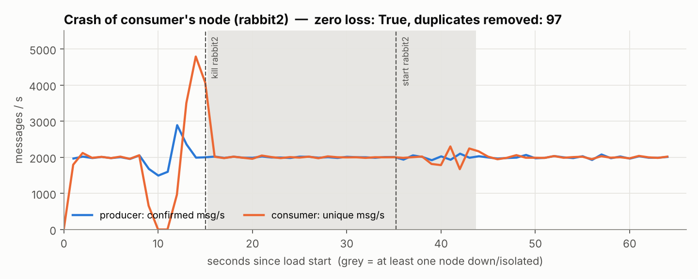
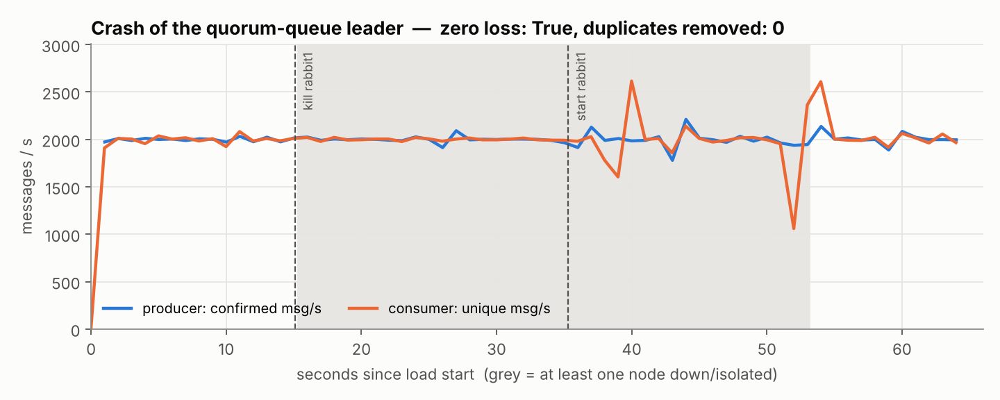
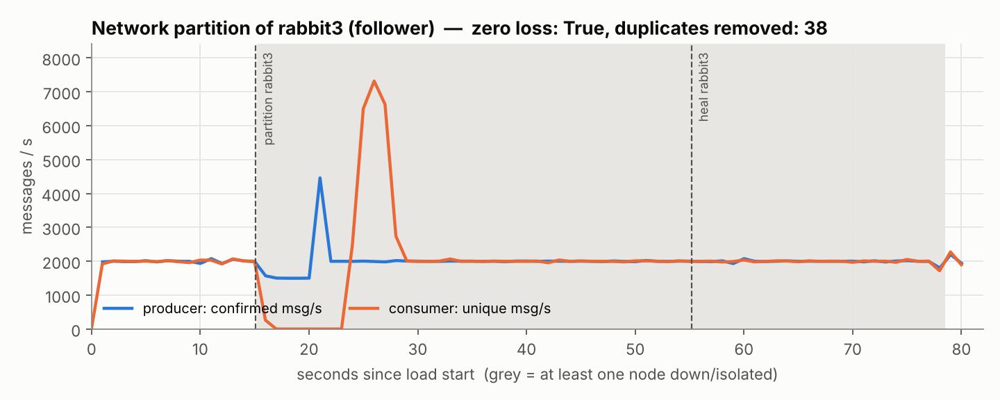
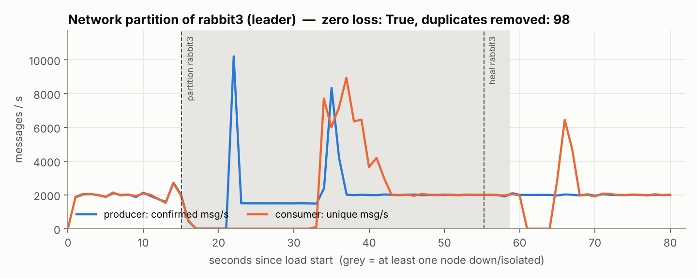
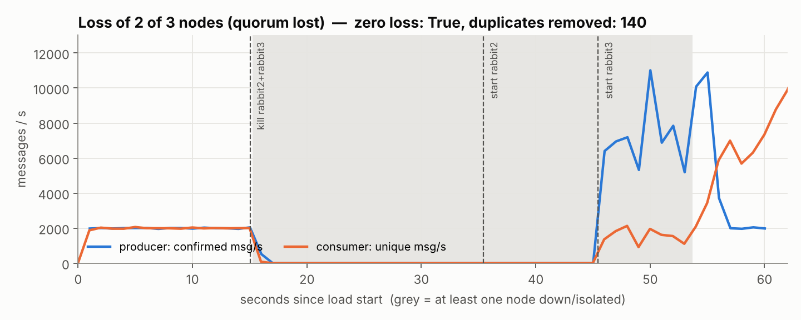
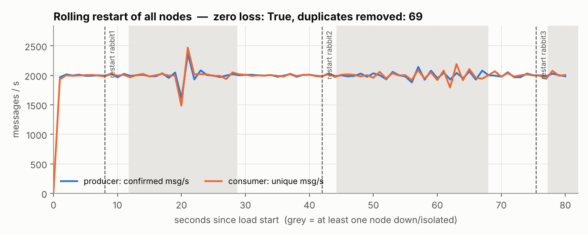
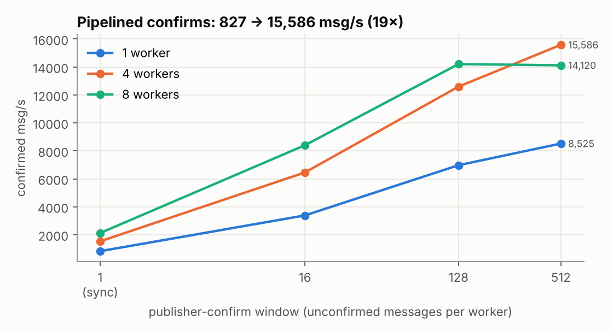
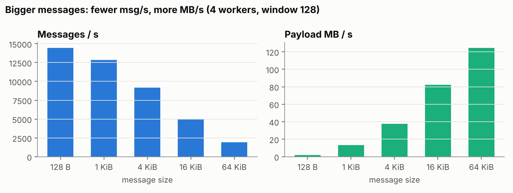
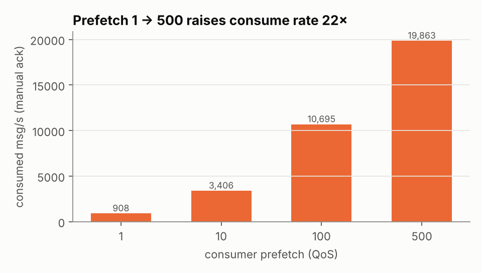
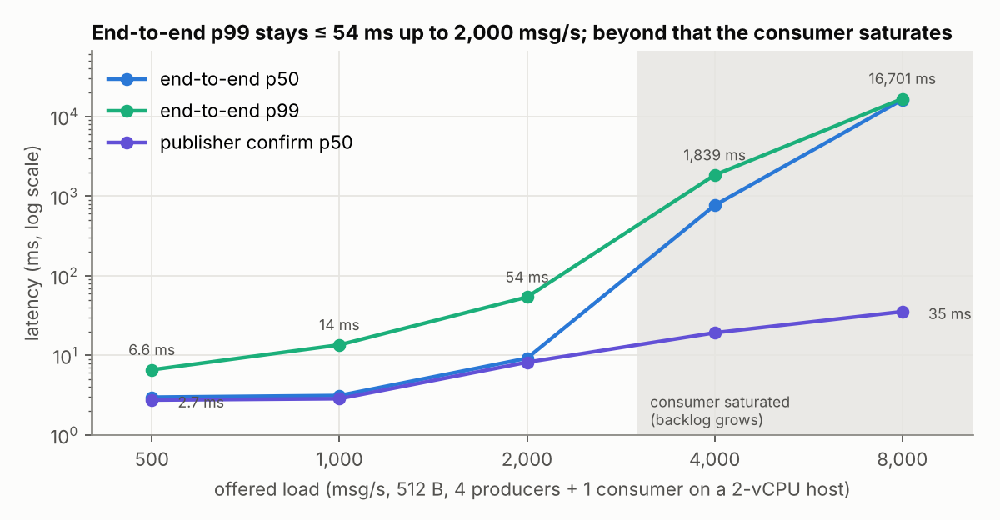

# Resilience & Benchmark Report — INFT 6000 HW2

> Generated by `scripts/make_report.py` from the files in `results/`. The full technical report
> (architecture, design rationale, discussion) is the team's shared document; this file is the
> reproducible data appendix that lives with the code. Environment: see `docs/TEST-HARNESS.md`.

## Headline

* **8 / 8 failure scenarios with zero message loss** (916,000 messages in total).
* Peak confirmed publish throughput: **15,586 msg/s**
  (4 workers, confirm window 512, 512 B persistent, majority-replicated).
* End-to-end latency p99 at 2,000 msg/s: **53.9 ms**.

## Chaos scenarios

Load: 4 producer workers, 2,000 msg/s total, 512 B persistent; 1 consumer, prefetch 100.
"Publish stall" = seconds with confirms below 50% of the offered rate.

| Scenario | Messages | Zero loss | Dupes removed | Out of order | Re-published | Leader before → after | Election (s)* | Publish stall (s) | Consumer detect / reconnect (s) | Rejoin (s) |
|---|---|---|---|---|---|---|---|---|---|---|
| baseline | 40,000 | True | 0 | 0 | 0 | – → – | – | – | – / – | – |
| node-crash | 128,000 | True | 97 | 12 | 48 | rabbit1 → – | – | 0 | 0.17 / 0.21 | 8.5 |
| leader-crash | 128,000 | True | 0 | 0 | 105 | rabbit1 → rabbit3 | 0.4 | 0 | – / – | 20.5 |
| partition | 160,000 | True | 38 | 67 | 74 | rabbit1 → – | – | 0 | 7.54 / 0.21 | 23.3 |
| partition-leader | 160,000 | True | 98 | 99 | 200 | rabbit3 → rabbit1 | 17.88 | 6 | 7.62 / 0.2 | 3.5 |
| quorum-loss | 120,000 | True | 140 | 133 | 212 | rabbit1 → – | – | 30 | 0.19 / 0.2 | 8.3 |
| rolling-restart | 160,000 | True | 69 | 0 | 60 | rabbit1 → rabbit2 | 8.69 | 0 | – / 0.21 | – |
| full-restart | 20,000 | True | 0 | 0 | 0 | – → – | – | – | – / – | – |

\* Election time is when `clustermon` (250 ms polling of the management API) first showed the new leader.
During a silent partition the cluster-wide API view blocks until `net_ticktime` expires, so for
`partition-leader` the client-side measure (publishes resumed after the stall) is the accurate one.

Timelines (grey = a node down or isolated):

## Benchmarks

### Publish throughput vs. confirm window

| Workers | Window | Messages | Confirmed msg/s | Confirm p50 (ms) | Confirm p99 (ms) |
|---|---|---|---|---|---|
| 1 | 1 | 1,500 | 827 | 1.132 | 2.277 |
| 1 | 16 | 12,000 | 3,384 | 4.225 | 11.823 |
| 1 | 128 | 12,000 | 6,975 | 15.108 | 55.976 |
| 1 | 512 | 12,000 | 8,525 | 54.27 | 105.712 |
| 4 | 1 | 6,000 | 1,533 | 2.305 | 6.306 |
| 4 | 16 | 48,000 | 6,457 | 8.307 | 27.587 |
| 4 | 128 | 48,000 | 12,594 | 34.63 | 82.874 |
| 4 | 512 | 48,000 | 15,586 | 105.009 | 249.625 |
| 8 | 1 | 12,000 | 2,124 | 3.239 | 8.84 |
| 8 | 16 | 96,000 | 8,402 | 12.708 | 34.031 |
| 8 | 128 | 96,000 | 14,208 | 58.945 | 254.44 |
| 8 | 512 | 96,000 | 14,120 | 207.852 | 989.797 |

### Message size (4 workers, window 128)

| Size (B) | msg/s | MB/s | Confirm p50 (ms) | Confirm p99 (ms) |
|---|---|---|---|---|
| 128 | 14,461 | 1.85 | 30.346 | 77.557 |
| 1024 | 12,863 | 13.17 | 33.093 | 91.675 |
| 4096 | 9,179 | 37.60 | 47.807 | 113.818 |
| 16384 | 5,015 | 82.16 | 83.306 | 226.601 |
| 65536 | 1,900 | 124.53 | 187.065 | 606.684 |

### Consumer prefetch (manual ack)

| Prefetch | Messages | Elapsed (s) | Consumed msg/s |
|---|---|---|---|
| 1 | 40,000 | 44.04 | 908 |
| 10 | 40,000 | 11.75 | 3,406 |
| 100 | 40,000 | 3.74 | 10,695 |
| 500 | 40,000 | 2.01 | 19,863 |

### Latency under load

| Offered msg/s | Achieved msg/s | E2E p50 (ms) | E2E p95 (ms) | E2E p99 (ms) | E2E max (ms) | Confirm p50 (ms) | Confirm p99 (ms) |
|---|---|---|---|---|---|---|---|
| 500 | 500 | 2.978 | 4.645 | 6.577 | 20.04 | 2.741 | 6.289 |
| 1,000 | 1,000 | 3.124 | 7.569 | 13.524 | 26.199 | 2.85 | 14.362 |
| 2,000 | 1,997 | 9.184 | 29.069 | 53.899 | 85.662 | 8.179 | 60.447 |
| 4,000 | 3,997 | 765.715 | 1556.919 | 1839.287 | 1880.422 | 19.2 | 190.166 |
| 8,000 | 7,911 | 16229.89 | 16613.252 | 16701.087 | 16733.718 | 35.379 | 130.983 |

Above ~3,000 msg/s the single consumer (sharing 2 vCPUs with 3 brokers and 4 publishers) falls behind,
so end-to-end latency becomes queueing delay; confirm latency stays low, i.e. replication is not the bottleneck.

## Defects found by these tests (all fixed before the final run)

1. Nacked channel kept nacking after a leader election → re-send on a fresh channel.
2. Switch-back requeued prefetched deliveries → graceful cancel + drain before reconnecting.
3. Publisher hung during a silent partition (blocked TCP write) → 5 s write deadline on the socket.
4. `pause_minority` never triggered in a short partition (`net_ticktime` 60 s) → `net_ticktime = 15`.
5. Failover waited 23.6 s on `Close()` to an unresponsive broker → abandon failed sessions asynchronously.
6. Rate limiter starved confirm processing (bogus 1 s confirm latency) → wait on slot *or* confirm.
